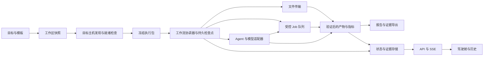

# 第一部分：项目目标、需求与核心契约

规格版本：1.0。建立日期：2026-10-11。

本文是长期稳定的产品与工程基线，描述“最终要保证什么”，不宣称这些要求已全部实现。实现差距见[第二部分](current-audit.md)，执行顺序见[第三部分](next-stage-plan.md)。日常只修正文义、补充边界和例子；改变目标、数据语义或执行责任属于规格升级，必须说明影响与迁移方式，不能为了迎合现有代码而改低要求。

## 1. 一句话目标与实际使用场景

**把 GPU 监控、远程任务、文件传输和 Agent 工作流串成可执行、可追溯的研究工作台。**

用户不只是想看到几张显卡，还希望知道：这次研究要用哪个仓库、哪个环境、哪些数据和哪台机器；为什么现在可以运行；运行中到底卡在哪一步；失败后从哪里继续；最后的指标和报告究竟由哪次执行产生。

首要用户是管理本机和若干 SSH GPU 主机的个人研究者、小型实验室。默认是单个本地服务、一个受信操作者，不以多租户云平台为当前目标。允许后续引入少量成熟依赖，不把“绝对零依赖”当成产品价值。

典型闭环：用户输入论文/仓库链接与研究目标 → 创建独立工作区 → 发现代码、环境和数据 → 人工确认关键配置或采用有来源的建议 → 生成可检查的执行包 → 准备/传输数据 → 排队执行 Job → Agent 等待结果并分析 → 验证指标与报告 → 查看、比较和导出证据。发现不足时回到具体阻塞项，不能靠一个强制运行按钮掩盖缺失。

支持两种入口：直接提交一个受控任务；从目标创建工作流。两者共用 Job、资源、日志和证据组件，不能维护两套任务生命周期。

## 2. 范围与边界

| 范围 | 要保证的行为 | 暂不追求的复杂度 |
| --- | --- | --- |
| 机器与资源 | 本地/SSH 主机、GPU、CPU、内存、进程、可达性、采样时间 | Kubernetes、Slurm 替代品、多租户配额系统 |
| 执行 | 顺序工作流、Agent/Job/Transfer 衔接、等待、恢复、重试、停止 | 在顺序闭环稳定前提供任意 DAG、动态多 Agent 群体协商 |
| 能力配置 | 模板、Agent、工具、模型路由；真实能力和限制可见 | 任意用户代码插件平台、运行时安装未知插件 |
| 数据与结果 | 文件传输、可验证 artifact、报告、指标、历史证据 | 默认保存每个 token、完整日志全部内嵌工作区 |
| 部署 | 单机服务，浏览器访问，私密信息留在本地 | 默认公网暴露、统一身份平台和计费网关 |

当前 UI 采用静态 HTML/CSS/JavaScript；后端采用 Python。这是当前部署选择，不是禁止采用现有库的理由。一个框架只有在替代具体职责、删除对应旧路径后才算简化。

## 3. 用户界面分工

- **监控控制台**：看主机与资源，提交/停止单个任务，终端、文件和传输操作。显示操作影响及任务归属。
- **工作区驾驶舱**：输入目标、选择实例、看就绪条件、提交工作流、等待/反馈/重试、检查历史与交付。下一步行动由后端给出，前端负责展示和交互。
- **配置中心**：编辑可复用模板、全局 Agent/工具/Provider，诊断能力与路由。修改全局配置不得悄悄改变已创建实例。
- **实例高级编辑**：确需修改当前实例时显示版本与影响；已经开始的 run 仍使用提交时快照。修改后续执行配置不等于改写历史。

从诊断页定位运行节点时，先切换到所属工作区与执行界面。选中的 run、节点和筛选条件不能被后台刷新无故重置。

## 4. 必要组件与输入、处理、输出

组件是职责边界，不要求每个组件都对应一个进程或一个新目录。实现时优先复用现有模块。

| 组件 | 接收输入 | 中间处理 | 输出及归属 |
| --- | --- | --- | --- |
| C01 主机目录与探针 | 本地配置、SSH 别名、刷新请求 | 合并配置、连接检查、nvidia-smi/系统探测、标注采样时间 | Host/ResourceSnapshot；探测失败保留“未知/陈旧”信息 |
| C02 工作区与模板 | 目标、仓库/论文/参考资料、所选模板、手工字段 | 校验输入、复制模板快照、标注默认/推断/手工来源 | Workspace、TemplateSnapshot、输入缺口 |
| C03 能力与路由目录 | Agent、工具定义、模型/搜索 Provider 配置 | 检查启用状态、真实适配器、允许工具、密钥和路由可用性 | 有效能力清单、诊断；不把注册当成实现 |
| C04 发现与环境规划 | 工作区、host_id、路径、仓库文件、数据线索 | 在目标主机读取、解析清单、验证数据根、提出环境命令 | 带来源与验证级别的发现结果；配置修改显式应用 |
| C05 执行包编译与门禁 | 工作区版本、选中节点、有效配置、资源快照 | 解析引用、检查依赖、生成命令/预期产物、冻结快照 | ExecutionPackage、阻塞/警告、内容标识 |
| C06 工作流协调器 | 执行包、启动/恢复/取消命令、Job 完成事件 | 持久化计划、决定下一步、等待异步结果、去重与恢复 | Run/StepAttempt 状态、调度指令；唯一负责工作流推进 |
| C07 Job 执行器与资源控制 | 具体命令、host_id、cwd、env、GPU 策略、依赖、幂等键 | 资源检查与占用、tmux 提交、退出码采集、停止与重连核对 | Job、日志引用、退出原因；唯一负责外部任务生命周期 |
| C08 文件与传输适配器 | 源/目标主机与路径、冲突策略、过滤项、归属 run/step | 预检、rsync、进度、退出码、必要的传后验证 | TransferRecord、已验证目标引用或失败原因 |
| C09 Agent 执行器 | 有效模型路由、允许工具、映射输入、预算、取消信号 | 调用模型、校验工具、受控副作用、结构化输出验证 | AgentExecution、ToolInvocation、输出/失败/等待引用 |
| C10 产物与报告存储 | 内容或已有文件引用、主机、类型、生成步骤、验证规则 | 写入/登记、大小和摘要、存在性/必要哈希验证 | ArtifactRecord、MetricRecord、Report；区分声明与实物 |
| C11 运行与证据存储 | 状态变化、尝试、外部任务引用、包快照、事件摘要 | 原子保存、版本/恢复、保留引用闭包、裁剪和导出 | 可追溯 run、重启恢复数据、明确完整性的导出包 |
| C12 API 与实时反馈 | 浏览器命令、筛选、事件游标 | 校验边界、调用服务、返回公开 payload、SSE 与重同步 | 稳定响应封装、状态 revision、事件；不拥有业务状态机 |
| C13 前端组合与控制器 | API 快照、SSE、用户动作 | 合并 revision、展示状态、收集表单、发命令 | 三个产品界面；不重新决定任务是否完成或可以执行 |

## 5. 需求编号与功能要求

### R01：机器与资源状态可信

输入为服务器配置、SSH config 和刷新频率；输出必须包含 host_id、可达性、监控能力、采样时间、数据是否陈旧、GPU/CPU/内存/进程信息及失败原因。主机可连接但没有 nvidia-smi，不等于主机离线；CPU 任务仍应有可用路径。一个主机失败不能令其他主机结果消失。

显卡候选是建议，采样值不是资源锁。任务真正启动前重新检查，并在本服务内部保留占用/预留，避免同一轮把多个任务同时分给一张“刚才空闲”的卡。不能承诺排除其他外部用户突然占卡；需把这类竞争变成可解释的等待或失败。

进程停止要实时核对 PID 与所有者；缓存不可靠或所有者未知时明确提示影响。终端、tmux 任务、GPU 进程是不同对象，停止其中一个不能暗示全部已停止。

### R02：工作区与模板快照明确

输入可包含目标文本、仓库 URL、论文 URL/本地资料、数据线索、现有目录、目标主机和模板。允许用户先提交不完整想法，结果是可编辑草稿，不是假装就绪。论文链接当前可先作为参考，不承诺自动读懂任意 PDF；自动解析需求须有对应适配器与验收。

每个工作区记录输入及其来源。模板更新不自动污染实例；迁移显示差异、风险和保留的历史，结构变化优先创建新草稿。人工字段优先，推断结果不能无提示覆盖。

### R03：能力和 Provider 路由真实

Agent 必须具有有效模型路由、工具允许列表、输出契约和预算。工具目录至少区分：真实读取、配置建议、配置修改、提交异步任务、危险控制、模拟/未实现。`implemented=true` 不足以表达上述差别。

LLM Provider 与 Search Provider 是不同能力。模型健康检查成功不代表搜索可用，模型列表可读不代表实际 completion 可用。无密钥本地模型可用；缺少必须的密钥或模型应给出具体阻塞字段。回退到其他供应商、模型或离线种子必须披露来源，不能暗中改变成本和数据去向。

### R04：发现结果在正确机器上成立

所有路径按 `(host_id, path)` 解释，同名本地路径不能替代远程路径。读文件、查数据、列目录、收集产物均通过同一主机适配器入口，返回 verified_at、来源与验证级别。

数据线索状态至少区分 hint、found、verified、missing、unknown；不存在与无权限/网络不可用不能合并。环境推断读取 requirements、pyproject、environment 等文件后给出建议，真正安装必须变成受控 Job。仓库、数据或命令变化后，旧验证结果不能继续代表新执行包。

### R05：执行包是可检查的提交快照

输入是工作区有效配置；输出冻结节点顺序、执行方式、输入映射、源代码引用、目标主机、工作目录、环境、数据、GPU 策略、命令、预期产物、预算和验证证据。记录 schema_version、workspace_revision、package_id 和字段来源。

内容相同的包可拥有相同内容标识；每次执行仍有不同 run_id。内容标识不等价于代码/数据完全可复现：未固定 Git commit、数据版本或环境锁文件时应明确记录限制。

门禁分成硬错误与可接受警告。缺主机、命令、必要输入、非法引用、无效工具/路由属于硬错误；陈旧采样等按明确策略重新检查或提示。高级重试可以承认特定警告，不能跳过隔离边界、幂等规则和真实产物校验。

### R06：工作流可以等待、恢复，完成含义准确

第一阶段先保证顺序链：每个节点只在前置条件满足后执行。Agent → Agent、Job → Agent、Agent → Job、Transfer → Job 使用同一规则。Job 的“提交成功”不是节点“执行完成”。Agent 提交子任务后，需要等待其结果或显式移交引用，不能无声丢掉后续节点。

Run 在首个副作用前记录完整计划。Step 与 StepAttempt 分开：重试产生新 attempt，保留原失败，输出绑定具体 attempt。进度分母是完整计划；可选步骤明确 skipped，尚未提交的步骤仍可见。Run 完成至少同时满足全部必需步骤达到终态和交付校验结果可见；execution_status 与 delivery_status 分开表示，避免“进程成功但报告缺失”被压成一个绿色状态。

服务重启后通过检查点与外部 Job 事实恢复，不能重新启动已提交任务。每个副作用具有稳定的幂等键；重复 HTTP、SSE、完成通知均不能重复执行。遇到无法确认“是否已执行”的窗口，进入需核对状态，不能盲目重试。浏览器关闭不取消运行。

### R07：Job、资源和命令生命周期受控

输入为 host_id、命令、cwd、env、资源条件、依赖和幂等键；输出包括任务标识、会话标识、启动/结束时间、退出码和日志证据。保留排队、等待资源、提交中、运行中、成功、失败、停止及事实未知的区别。

只有明确退出码为 0 才能认定成功。SSH 断开不等价于远程进程退出；服务重连先核对会话/结果标记。部分提交失败要保留已提交任务并显示处置，不能抹掉记录。重试前判断命令是否可安全重复，尤其下载、写文件和环境创建。

本地与远程执行共享 payload 和结果结构；不能由 Agent 绕过队列直接执行 SSH/shell。GPU 为 none 的任务按 CPU 路径处理，不应等待显卡。

### R08：传输属于研究流程的一部分

源和目标均包含主机、路径与文件/目录语义；输入还包含过滤规则、冲突策略及 run/step 归属。先检查路径权限、敏感路径、目标空间和 SSH 参数；冲突处理分清跳过、覆盖、另存，不默认进行不可见的覆盖。

支持独立传输，也支持把传输作为工作流前置/结果回收步骤。复用已有 rsync 与 Job 执行，不另写一个文件调度器。返回进度只是反馈；成功以退出码和必要的目标验证为准。目录尾斜杠、空格、特殊字符、不同 SSH 端口、断线重试都要有明确语义。跨远程主机传输要声明直接传还是经本机中转及其限制。

### R09：Agent 的答案与副作用分开判断

输入是本次运行的映射值、有效工具、模型路由和总预算。模型输出需按节点契约验证；JSON 可解析不代表业务字段齐全。输出引用必须带 run/step/attempt 来源，不能把同名历史输出当成刚完成的前置结果。

调用前、调用后、执行工具前、返回成功前检查截止时间和取消。重试和供应商回退共用剩余预算，不能每次重新获得完整超时。工具错误、被阻止的副作用、子任务失败不能被模型一句“完成”覆盖。

取消应区分已请求、正在停止、已停止；是否同时取消已提交子 Job 由显式策略决定。失败回复与离线规则回复都可展示，但必须标明执行结果和来源。上下文反思由用户接受/撤销，不自动改写目标。

### R10：产物、指标与报告可以拿到

Artifact 至少记录生成 run/step/attempt、host_id、位置、类型、大小、生成/验证时间及状态。声明路径、写入内容、验证存在是三件事；不能返回 written 却既不写文件也不保存全文。

报告可先保存为受控本地文本文件并登记引用，不要求大型文档系统。长内容按文件/对象引用保存，工作区只保留摘要；必须保留正文，不能超过阈值就静默丢弃。远程产物未回收到本机时清楚标明下载路径和主机。

指标记录名字、值、单位、数据集/划分和来源；比较只比较相同语义的指标。报告成功需有可访问正文或已验证文件，缺失产物允许 run 执行结束但 delivery 显示 incomplete。

### R11：证据、保留与导出边界明确

保留执行包、计划步骤、每次尝试、外部任务、模型与工具摘要、退出原因、指标、产物和事件关联。日志/流允许按容量裁剪，但保存明确的截断计数与范围；“完整历史回放”不能指只有几十行尾日志。

区分三个能力：运行摘要回放、重新执行、离线证据导出。重新执行创建新 run，不覆盖原 run，也不保证位级复现。摘要导出可为 JSON；完整证据包按需包含报告和选定文件，标明缺失、被裁剪和未下载内容。

清理前从保留 run 计算子 run/Job/日志/产物引用闭包。预览缓存可以过期，仍被保留执行引用的证据必须遵从明确保留政策。手工删除证据要留下不可用状态；远程不可达时记录待清理，不宣称成功。

### R12：API、SSE 与页面状态一致

API 是命令/查询，SSE 是通知，持久状态是事实。前端重连、刷新或事件丢失时取后端快照恢复；迟到事件不覆盖更新的 revision。SSE 的 session 游标不能被当成跨重启的永久事件身份。

公开数据隐藏密钥和内部日志存储路径，保留用户定位研究目录所需信息。公开字段与内部存储字段分别定义；错误应包含可操作的 code、原因、关联对象和可重试性。POST 重复请求具备幂等语义。HTTP 边界校验 JSON 类型、大小、路径段和参数范围，不能让错误拖垮后台循环。

### R13：存储、私密信息和运行边界

静态样例与本地运行数据分开。密钥加密落盘，主密钥不入库；丢失主密钥时明确报不可解密，不能把配置默默当空白继续覆盖。默认本地绑定；若未来提供共享访问，先单独设计访问控制，不能直接把现有命令接口变成公网服务。

配置/小型目录可以继续 JSON；需要恢复、关联和事务的执行状态使用有事务的本地存储。SQLite 是轻量候选，无需为单机引入 Redis/PostgreSQL。原子替换一个 JSON 文件不等于多个文件和外部副作用的一致事务。

持久化必须能识别损坏、备份/迁移版本，并区分“首次没有文件”和“已有文件读坏了”。服务退出要明确后台线程、子进程与终端的处理，服务启动核对外部任务而不是无条件重新提交。

### R14：部署与可维护性

明确 Python 版本、运行依赖、可选开发依赖和系统工具，给出最小启动命令。缺少 GPU、tmux、rsync、SSH 或 Provider 时，显示对应能力不可用，不能让整个应用因为可选功能缺失而无法说明问题。

模块以职责收敛，纯函数负责转换，服务负责状态，适配器负责外部调用。状态机、引用解析、能力目录、公开脱敏、布尔参数解析和终态判断应有单一权威。兼容门面可以保留，但必须有已知调用者与退出条件，不以“文件多”或“行数少”作为优化目标。

## 6. 关键对象的最小数据契约

这是目标逻辑模型，字段名不要求本轮立即修改现有 v1 API。实施时通过版本化适配保持旧消费者可用。

| 对象 | 至少需要的字段 | 不应混淆的语义 |
| --- | --- | --- |
| ResourceSnapshot | host_id、collected_at、reachable、capabilities、resources、stale/error | 可达 ≠ 有 GPU；采样空闲 ≠ 已预留 |
| Workspace | id、revision、目标/输入、字段来源、模板快照、实例覆盖 | 草稿可保存 ≠ 可以运行 |
| ExecutionPackage | schema_version、内容标识、workspace_revision、计划、目标、证据、预期交付 | 同内容包 ≠ 同一次执行 |
| Run | id、package_id、计划步骤、cursor/waiting_on、revision、execution_status、delivery_status | 已提交部分任务 ≠ 完整运行 |
| StepAttempt | run_id、step_id、attempt_id、输入来源、状态、开始/结束、错误、输出引用 | 重试新尝试 ≠ 覆盖旧步骤 |
| Job/Transfer | id、host/source/target、幂等键、资源/依赖、外部会话、状态/退出码、日志引用 | accepted/submitted ≠ succeeded |
| AgentExecution/ToolInvocation | 路由与模型、允许工具、预算、调用关联、结果/副作用/子任务 | 最终答案成功 ≠ 工具副作用成功 |
| Artifact/Metric/Report | 来源 attempt、主机、存储引用、验证状态、完整性/摘要 | 声明路径 ≠ 已验证文件 |
| Event | 事件身份、对象与 revision、类型、时间、摘要、截断信息 | 实时通知 ≠ 唯一持久事实 |

输出引用推荐指向确定的 `(run_id, step_id, attempt_id, output_key)`；引用模板里的符号名由编译阶段解析。历史输出复用必须显式声明来源，不能默认混入本次上下文。

状态模型最低原则：尚未开始 → 就绪/等待 → 提交/运行 → 成功/失败/取消/跳过；事实无法核对时标为 unknown/reconciling，不能猜成成功。具体枚举由实现契约统一映射到旧 API，避免前后端各增一套状态名称。

## 7. 典型异常与处理要求

| 实际情况 | 必须发生的处理 |
| --- | --- |
| 首次启动未配模型或没有显卡 | 可进入应用；对应 Agent/GPU 能力显示缺口，其他功能仍可用 |
| 论文没有可直接运行的仓库 | 保留研究草稿与参考来源，要求补代码/命令，不伪造环境 |
| SSH 超时、监控数据陈旧 | 标注未知/陈旧；重查外部任务与资源，不能立即判任务失败或启动新副本 |
| 文件路径存在但属于另一台机器 | 按 host_id 分开验证，阻止错用本机同名路径 |
| 盘符断开、目录无权限、符号链接敏感路径 | 单个条目失败可见，其他浏览可继续；沿用路径边界 |
| 数据根只是线索或不完整 | 数据门禁保留 hint/incomplete，明确下一步验证 |
| GPU 同时被多个排队任务选中 | 本服务原子预留；未拿到资源的任务继续等待 |
| 环境安装失败或需要交互输入 | Job 失败/阻塞并保留尾日志；不得把安装建议当成功 |
| 传输中断、目标冲突或空间不足 | 保留部分传输状态与冲突决策；按已定义重试策略恢复，避免重复覆盖 |
| 模型 429/5xx、网络断流 | 有限重试并共享总预算；保存部分结果为不完整，工具副作用不自动重放 |
| 模型 JSON 语法正确但字段缺失 | 输出契约校验失败，后续步骤不接收假成功 |
| 超时/取消发生在模型返回前后 | 返回后再次检查，停止新副作用；已提交子任务按明确策略处理 |
| 第三个节点提交失败，前两个已启动 | 保留前两步，追加失败，显示哪些任务还在运行及后续未执行步骤 |
| 服务在提交 Job 后、保存返回前崩溃 | 用幂等键与外部会话核对，不能盲目重启相同命令 |
| 浏览器关掉、SSE 丢事件、迟到事件 | 运行继续；快照重同步；revision 阻止状态回退 |
| 全部命令退出 0，但报告文件缺失 | execution 可结束，delivery 不完整，并指出缺哪个产物 |
| 长报告、超大日志、很长子运行树 | 正文另存，摘要有上限；显式完整性标记，保留引用 |
| 清理与导出同时发生、远程离线 | 保护引用中的证据；导出标注缺失/待取，清理标注待完成 |
| 模板/Provider 在执行期间被编辑或删除 | 当前 run 使用快照和可解析路由记录；下一 run 重新校验 |
| 数据文件损坏或主密钥丢失 | 进入明确恢复流程，保存坏文件/错误，不能覆盖为默认空数据 |

## 8. 技术选择原则

保留系统成熟能力：SSH 负责连接，tmux 承载长命令，rsync 负责增量传输，nvidia-smi 负责 GPU 探测。项目负责把它们纳入统一执行事实与证据，不重写远程终端或文件同步协议。

LangGraph 可承担持久工作流推进；LiteLLM SDK 可承担多供应商调用与响应规范化。两者仍需项目适配器连接 Job、权限、数据契约、预算和证据。先用最小场景证明能减少代码，再替换对应旧实现；不同时保留两套主执行器和两套 Provider 协议层。

每次复用评估要回答：替代哪段代码、额外依赖与存储是什么、网络/隐私边界是否改变、失败与升级如何处理、怎样退出旧实现。具体选型和评估链接保存在第三部分，本文不因某个库升级而反复改写。

## 9. 最小验收场景

最终核心闭环至少通过：一个本地 CPU Job → Agent 报告；一个 SSH Job → Agent 报告；Agent 提交子 Job 后等待并续跑；一次带数据传输的任务；一次中途失败后重试；一次等待期间服务重启；一次重复提交/重复完成通知；一次缺失报告的运行；一次清理后仍可导出保留证据。

测试层次分别是纯契约、受控适配器集成、真实机器/浏览器 smoke。假 Provider 能证明控制流程，不能证明某家供应商真实可用；跳过 smoke 必须记为未验证。验证与消融规则见根目录 [AGENTS.md](../AGENTS.md)。
